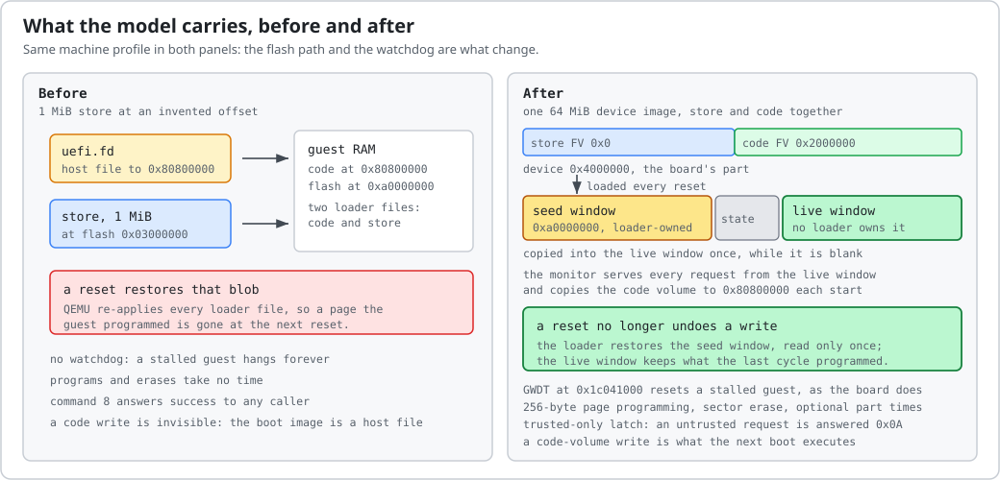

# Backend decision and evidence

Decision date: 2026-10-28. Working focus: the DGX Spark SoC boot / UEFI path.
QEMU now runs the pinned SoC 2.158.15 UEFI and Standalone MM payloads; see
[measured boot status](boot-status.md) for the verified execution boundary.

## What is established

NVIDIA's [Spark software stack documentation][nvidia-stack] describes UEFI,
capsule-based firmware updates, LVFS delivery, and ConnectX-7 networking.
Its [release notes][nvidia-release] track SoC, UEFI, embedded controller, USB PD,
and TPM firmware separately. An OS recovery image, an update capsule, and a
component executable are different artifacts.

The [MT8901 pinctrl work][pinctrl] exposes ACPI GPIO and wake-event behavior.
The [SSPM / power_wrap work][sspm] exposes host-to-firmware power requests using
a vendor SCMI transport. The [audio work][audio] concerns N1x/MT8901 SoundWire,
ASoC, and DSP power management. These are useful implementation references;
N1x laptop behavior must be checked against the selected Spark board and
firmware revision before treating it as a Spark hardware fact.

The [pinned SSPM source][sspm-source] provides concrete relative interface facts:

| Interface fact | Value in the reference driver |
| --- | --- |
| ACPI match IDs | `MTKW8400`, `NVDA8400` |
| Mailbox count | 2 |
| Mailbox stride | `0x10000` |
| Input doorbell offset within mailbox | `0x1000` |
| Output acknowledge/clear offset | `0x1004` |
| Vendor TINYSYS SCMI protocol ID | `0x80` |
| Physical base and interrupts | Obtained from platform/ACPI resources |

These offsets are not a complete hardware specification. In particular,
the physical base, IRQ assignments, reset state, firmware ISA, and executable
entry point remain unverified for our target. A host-side driver describes
one side of a protocol, not the remote processor's implementation.

## QEMU backend

| Need | Implementation and status |
| --- | --- |
| AArch64 application processor and UEFI work | Existing Arm system models plus the Spark firmware profile |
| Custom registers and controller behavior | C device models and board integration |
| Isolated MT8901-related controller firmware | Identify its ISA and load contract before extending the emulator |
| Unmodified DGX Spark firmware | UEFI and real MM reach AMI setup; native IPv4 PXE downloads and executes an original EFI application |
| GB10 GPU execution / CUDA | Not implemented |

QEMU's [`virt` board][qemu-virt] deliberately describes generic virtual hardware.
Its [`sbsa-ref` board][qemu-sbsa] is intended for firmware development, but also
has its own hardware contract. Neither is a substitute for a GB10 machine.
The installed QEMU 11.1.2 machine list had no DGX Spark / GB10 / MT8901 target.

## Implementation boundary

Build toward a custom Spark machine description and only the devices exercised
by a chosen firmware checkpoint. Capture the PC and address of unknown MMIO
accesses. Record every stub, its observed behavior, and the checkpoint it
enables. A constant-success mailbox stub is a protocol approximation, not
execution of the remote controller firmware.

Do not assume the main AArch64 processor's ISA applies to the EC, SSPM, DSP,
USB PD controller, NIC, or other firmware processors. CPU feature requirements,
exception level, secure monitor/FF-A services, reset vectors, RAM/flash layout,
interrupt wiring, and capsule payload boundaries must come from evidence.

## What this machine models, and what it does not

Two program models exist for a page write, and a receipt names the one that produced it:
`page-before-delay-v1` commits the request and then spends the page budget, while
`linear-request-byte-v1` spreads the budget over the bytes the pulse covers so a reset can leave a
prefix written. The second is an approximation of how the die settles, not a measurement of it.

The loader tag can describe RAM above 4 GiB — its region bases and sizes are 64-bit — but that is
opt-in (`--extended-ram`) because the machine's high MMIO windows are not modelled. What a host can
actually allocate is a separate limit: the measurements in this repository stop at 3 GiB, and a
larger allocation has not been exercised here.

The machine boots the board's own firmware images and reproduces the board's flash geometry: a 64 MiB
part with the variable store at `0x0` and the code volume at `0x2000000`, programmed in 256-byte
pages and erased in 4 KiB sectors, with the GWDT at `0x1c041000` resetting a stalled boot. Those are
the parts firmware behaviour depends on, and they are covered by tests that do not need a board.

The flash survives a machine reset, as the part does. A `-device loader` blob is a ROM to QEMU and is
re-applied on every reset, so the image the loader carries is only the seed: the monitor copies it
once into a second window the loader does not own (`0xa0000000 + NOR_SIZE + 0x1000`) and serves every
request from there. A page programmed before a watchdog reset is therefore still programmed after it,
which is what a reboot cycle on a poisoned store depends on — otherwise each cycle would start from
the image the run began with and re-write the same bytes for ever.

The same applies to the code half. The loader replays its file on every reset, so a boot image sliced
out of the flash would be frozen at the moment the run started; the monitor instead copies the code
region out of the live window on every start, and a code byte the firmware programmed is what the
next boot executes.

It is not a GB10. The GPIO/EINT banks, the UART and the RTL8168 model are approximations for the
paths they are used on; there is no SPI controller in the normal world (the board's belongs to the
Flash Service partition), one running CPU by default instead of twenty (a second can be modelled,
parked until the monitor's `CPU_ON` releases it), and 2 GiB of DRAM by default instead of board-class memory — the
profile aliases PCI BAR space over the lowest gigabyte, and the loader tag describes the rest of the
allocation, so `--memory` beyond that adds usable RAM rather than hidden RAM. Each
of those is named below with its reason and what would close it, so a result taken here can be
attributed to the firmware rather than to the model:

| Not modelled | Why | What closes it |
| --- | --- | --- |
| Where a power loss lands inside a page | the model commits a page and then spends its time; a torn page is a property of the silicon | a part on a bench with a switchable supply |
| The part's real erase and program times | `--board` applies datasheet-typical values (400 µs a page, 40 ms a sector); the board's own part has not been timed | a metered part, or a timing run on a unit |
| An eSPI bus or controller | the **service behind it is modelled where it is reachable**: `monitor/fan.c` answers `SMC 0xC400008D` on endpoint `0x8003`, and that is how the fan results are taken. The eSPI link itself — the peripheral's registers, its cycles on the wire — is not modelled, and no result here depends on it | a test that needs the eSPI link rather than the service |
| A board-faithful storage topology | emulated NVMe controllers support installer restoration and installed-kernel handoff, not the board's complete storage topology | measured device and stream mappings |
| Board-class RAM and 20 CPUs (one or two are modelled; `CPU_ON` can release the parked secondary) | the vendor platform description still activates one CPU, and the loader tag stops describing memory at `0x100000000`, so at most 2 GiB is usable | a matching MADT and loader tag, a profile with more CPUs, and a host with the memory |

The tools inspect local artifacts and run the emulator. The separate,
explicitly invoked hardware collector performs read-only SSH inventory reads.
No physical register writes or firmware update operations are implemented.

[nvidia-stack]: https://docs.nvidia.com/dgx/dgx-spark-porting-guide/latest/porting/software-requirements.html
[nvidia-release]: https://docs.nvidia.com/dgx/dgx-spark/release-notes.html
[pinctrl]: https://github.com/NVIDIA/NV-Kernels/pull/564
[sspm]: https://github.com/NVIDIA/NV-Kernels/pull/570
[audio]: https://github.com/NVIDIA/NV-Kernels/pull/566
[sspm-source]: https://github.com/NVIDIA/NV-Kernels/blob/0697f87f98083d0af96676725709e760543b7a07/drivers/soc/mediatek/sspm_ci/sspm_ci.c
[qemu-virt]: https://www.qemu.org/docs/master/system/arm/virt.html
[qemu-sbsa]: https://www.qemu.org/docs/master/system/arm/sbsa.html
